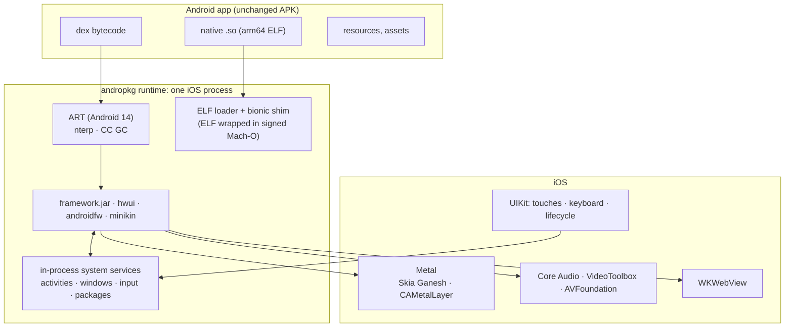

<div align="center">

# andropkg

**Run Android apps on iPhone natively: no virtual machine, no JIT, no emulated kernel.**

-black?logo=apple)
-3DDC84?logo=android&logoColor=white)


*An APK is a set of arm64 machine code and dex bytecode. So is an iPhone app. andropkg keeps
only the parts of Android an app actually talks to and puts iOS underneath.*

[How it works](#how-it-works) · [What works](#what-works-today) · [Performance](#performance) ·
[Build it](#build-and-run) · [Roadmap](docs/ROADMAP.md)

</div>

---

## Why

Other ways of running Android apps on an iPhone boot a whole Android (Linux kernel, init,
zygote, system_server, SurfaceFlinger) inside a virtual machine. That means one app costs a
whole OS, it runs only in the foreground, and it needs a JIT that iOS doesn't really allow.

andropkg is closer to **Wine for Android**:

- The app's **dex bytecode** runs on the real **Android 14 ART**, compiled for iOS. It uses ART's
  assembly interpreter (nterp), so no JIT is involved.
- The app's **native `.so` libraries** run as they are. Android and iOS are both arm64, so the
  ELF code is wrapped into signed Mach-O images and linked by our own ELF loader.
- The real **Android framework** (`framework.jar`, hwui, Skia, androidfw, minikin) runs in the
  app's own process.
- **Everything below the framework is iOS:**
  - Activities, windows and input are handled by lightweight system services in the app itself,
    so binder is not needed.
  - Rendering goes to Metal, audio to Core Audio, video to VideoToolbox, and WebView to WKWebView.

Each Android app becomes an ordinary, signed iOS app. It launches in about 2 seconds and uses
the memory of a native app.

## What works today

| Area | Status |
|---|---|
| **Runtime** | Android 14 ART + libcore on iOS. nterp assembly interpreter, concurrent copying GC with read barriers, JNI, threads, ICU, tzdata. |
| **Framework** | `framework.jar` and `framework-res` in one process. Activities, fragments, services, broadcasts, content providers, settings, accounts, keystore, notifications. |
| **UI** | Views and Jetpack Compose. Multi-touch with batched history, the iOS keyboard as the IME, dialogs and popups, multi-window composition, `RenderNode`, `RenderEffect` blur. |
| **Graphics** | hwui draws through **Skia Ganesh on Metal**, double-buffered per window, into a `CAMetalLayer`. GLES 2/3 for NDK and `GLSurfaceView`. `SurfaceView`, `TextureView`, `SurfaceTexture`. |
| **Native code** | Unmodified NDK `.so` files: ELF in Mach-O, bionic ABI on Darwin, TLS, syscall trampolines, libraries built for 4 KB pages relaid out for 16 KB pages. |
| **Media** | `MediaCodec`:<br>• AAC, MP3, Opus, Vorbis.<br>• **H.264 and HEVC through VideoToolbox**, zero-copy to the GPU.<br><br>`MediaExtractor` for MP4/Ogg, and `MediaPlayer`/`VideoView`.<br><br>AudioTrack, AAudio and OpenSL ES on Core Audio.<br><br>ExoPlayer/Media3 work. |
| **Web** | `android.webview.WebView` on WKWebView: JavaScript bridge, cookies, navigation callbacks. |
| **Storage & net** | Android paths mapped into the iOS sandbox. SQLite, SharedPreferences, sockets, TLS (Conscrypt/BoringSSL). |

### Real apps

- **Yandex Music.** Works end to end:
  - sign-in through its WebView flow, and the sign-in persists;
  - Compose home screen, search and profile;
  - music playback through ExoPlayer;
  - video track covers through `TextureView`.
- **Spotify.** Reaches its first frame in about 2 s and signs in.

A corpus of 17 test apps (`tests/apps/`) covers lifecycle, widgets, input, multi-touch, multi-window, storage,
media, video, NDK, GLES, WebView and GPU memory. It runs on every change.

## How it works



Some of the less obvious pieces:

- **No memory below 4 GB.**
  - ART stores object references as 32-bit values, but iOS maps nothing below 4 GB.
  - andropkg reserves a 4 GB reference arena pinned at `0x7000000000`. A reference is the
    pointer's low 32 bits, and turning it back into a pointer is a single
    `orr xN, xN, #0x7000000000`, an AArch64 logical immediate. This is how nterp's hand-written
    assembly runs unchanged in spirit.
- **nterp on Mach-O.**
  - ART's assembly interpreter is generated from its templates and ported from ELF/GNU-as to
    Apple's assembler at build time (`tools/nterp_macho.py`).
  - Every dereferenced reference is decompressed.
  - The card-marking write barrier is fixed to use full addresses.
- **ELF inside Mach-O.**
  - The converter re-packs ELF segments into a signed Mach-O dylib at the same relative
    addresses, so ADRP and GOT addressing keep working.
  - Before signing it rewrites `svc #0` into syscall trampolines and `mrs tpidr_el0` into loads
    of the bionic thread pointer. XNU owns `TPIDR_EL0`, so the instruction cannot be left as is.
- **ART method overrides.** A short table makes selected framework methods native, so the
  runtime can supply behaviour that otherwise assumes a hardware renderer, for example
  `Canvas.drawRenderNode` on software canvases and `TextureView.draw`.
- **Build without Soong.** `tools/bp.py` reads `Android.bp` and `tools/gen_cmake.py` writes
  CMake. AOSP changes live as patches in `runtime/patches/`.

The original design document (in Russian) is [docs/PLAN.md](docs/PLAN.md).

## Performance

Measured on an iPhone 16 Pro and an Apple silicon Mac, release build.

| | Before | Now |
|---|---|---|
| Method calls (`fib`), switch interpreter → nterp | 34 ms | **5 ms** (~7×) |
| String building | 62 ms | **15 ms** (~4×) |
| `HashMap` churn | 831 ms | **330 ms** (~2.5×) |
| Frame rasterization | CPU (Skia raster) | **GPU (Metal)** |
| VM start | – | **~350 ms** |
| App to first frame (Spotify) | – | **~2 s** |
| Memory, Yandex Music while browsing | – | **~400 MB**, stable |

Android renders at 2 px/pt on 3× screens and iOS scales the result (`ANDROPKG_RENDER_SCALE`
overrides this).

## Build and run

**Requirements**
- An Apple silicon Mac (macOS 14.4 or later) with Xcode.
- Homebrew: `brew install lld xcodegen ffmpeg openjdk@17`.
- The Android SDK with build-tools 36 and a platform `android.jar`, used to build the Java
  parts and the test APKs. See `scripts/build-java.sh` for the paths it expects.
- An iPhone with iOS 17.4 or later. A free Apple developer account is enough.

```sh
# 1. Sources and Android 14's Java side (about 450 MB of AOSP, plus the emulator image's jars)
scripts/fetch-aosp.sh
prebuilts/extract-android14.sh

# 2. Your signing identity (gitignored)
cp Config/Local.xcconfig.example Config/Local.xcconfig   # DEVELOPMENT_TEAM, bundle id prefix

# 3. The runtime for the Mac (the fast development loop) and the test corpus
cmake -S runtime -B build/runtime-macos -G Ninja && ninja -C build/runtime-macos
scripts/build-java.sh
scripts/test-mac.sh              # every test app, with pixel checks

# 4. On the iPhone (the runner configures and builds the iOS runtime, then installs and launches)
scripts/runner-ios.sh --apk hello                    # a test app
ANDROPKG_INTERACTIVE=1 scripts/runner-ios.sh --apk <name>
#   ^ your own APK: build/apps-ext/<name>.apk (gitignored)

# 5. One Android app as its own iOS app: name, launcher icon, preverified classes
scripts/convert-ipa.sh path/to/app.apk -o app.ipa --install
```

<details>
<summary><b>Debugging switches</b> (environment variables, passed through to the iPhone by the runner)</summary>

| Variable | Effect |
|---|---|
| `ANDROPKG_NO_NTERP=1` | Use ART's C++ switch interpreter instead of nterp. |
| `ANDROPKG_NO_GPU=1` | Rasterize on the CPU instead of Metal. |
| `ANDROPKG_RENDER_SCALE=3` | Render at native resolution. |
| `ANDROPKG_LOG_THROWS=<lines>` | Log every thrown exception, with stack depth `<lines>`. |
| `ANDROPKG_LOG_MEDIA=1` | Trace MediaCodec, MediaExtractor and MediaPlayer. |
| `ANDROPKG_LOG_MEMORY=1` | Log the app footprint and GPU memory. |
| `ANDROPKG_LOG_RENDERNODES=1` | Dump the RenderNode trees drawn by software canvases. |
| `ANDROPKG_NO_VDEX_CACHE=1` | Use the verification caches read-only (`=2`: not at all). |
| `ANDROPKG_NO_PREVERIFY=1` | Build without verifying classes ahead of time. |
| `ANDROPKG_CHECK_REFS=1` | Check every JNI reference argument (finds bad decoding). |
| `ANDROPKG_LOG_JNI=<class prefix>` | Trace JNI calls into matching classes. |
| `ANDROPKG_LOG_NDKFS=1` | Trace NDK file system calls. |
| `ANDROPKG_LOG_NDKNET=1` | Trace NDK network calls. |
| `ANDROPKG_TEST_SCRIPT="wait 2000; tap x,y; pixel x,y"` | Script input and check pixels. |

</details>

## Repository layout

```
runtime/        CMake build of ART, libcore, the framework's native side and andropkg's bridges
  art/            Darwin pieces of ART (native stacks, in-process JNI invocation)
  android_runtime/, graphics/, media/, opengl/, webview/   framework JNI on iOS
  compat/         Linux compatibility: futex, epoll, paths, the reference arena
  patches/        changes to AOSP, applied on fetch
services/       Java: the in-process system services (activities, windows, packages, ...)
ndk-libs/       the NDK's public libraries on Darwin (libc, libandroid, AAudio, OpenSL ES, ...)
loader/         ELF loader for wrapped images
converter/      Swift: ELF to Mach-O wrapping, instruction rewriting, 4 KB to 16 KB relayout
host-app/       the iOS app that hosts the runtime
shim/           syscall and TLS trampolines
tools/          Android.bp to CMake, ELF assembly to Mach-O, nterp port
tests/apps/     the test corpus
scripts/        build, run and test helpers
docs/           design notes and roadmap
```

## Roadmap

The full list with milestones is in [**docs/ROADMAP.md**](docs/ROADMAP.md). In short:

- ✅ **M0–M5:** ART on iOS, the framework, interactive apps, NDK, media, WebView, video, and
  installing APKs.
- ✅ **Speed:** nterp, GPU rendering, 2× render scale.
- 🔜 **Next:**
  - AOT compilation (dex2oat output signed like `.so` files) and a boot image for instant start;
  - wider app compatibility from a corpus of popular APKs;
  - camera, notifications on iOS.

## Limitations

- **Experimental.** Many apps will hit unimplemented corners.
- **No Google Play Services.** Apps that require them won't sign in or will degrade.
- **No anti-tamper apps.** Apps that issue raw syscalls from encrypted code can't be supported:
  the code can't be rewritten before signing.
- **Distribution is sideloading only.** Use a free Apple developer account, AltStore/SideStore,
  or a similar tool.

## Legal

andropkg isn't affiliated with Google, Apple or the makers of any app mentioned here.
- **Trademarks.** Android is a trademark of Google LLC.
- **AOSP code.** The AOSP sources it builds on are under their own licenses (mostly
  Apache 2.0); see `third_party/` after fetching.
- **Apps.** You need the rights to the APKs you run.
- **This project's license.** No license has been chosen for andropkg's own code yet.
